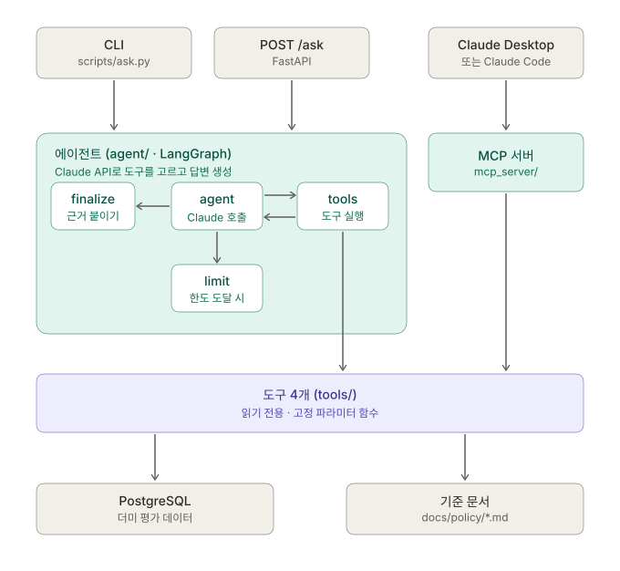

# eval-agent



평가 데이터를 자연어로 물어보면, LLM이 필요한 도구를 직접 골라 DB를 조회하고 근거와 함께 답해 주는 서비스. 
Python, LangGraph, MCP를 사용했습니다.

> 예: "2025년 영업본부 B등급 비율이 왜 다른 본부보다 높아?"

## 왜 만들었나

- Java/Spring으로만 일해서 Python 경험이 없었는데, Python 프로젝트와 LangGraph, MCP를 처음부터 끝까지 직접 해 보고 싶었습니다.
- 동작하는 코드만이 아니라 "왜 이렇게 만들었는지"를 설명할 수 있게, 단계마다 설계 이유와 한계를 작성했습니다.
- 이전에 Spring AI로 평가 문의 자동 분류 시스템을 만들었는데, 그건 정해진 순서대로 도는 워크플로였습니다. 
- 이번에는 LLM이 어떤 도구를 부를지 직접 고르는 에이전트로 만들어서 둘의 차이를 비교해 보려고 했습니다.

## 지킨 원칙

- 도구는 자유 SQL을 받지 않습니다. 정해진 파라미터만 받는 읽기 전용 함수라서 LLM이 DB를 마음대로 건드릴 수 없습니다.
- 도구를 먼저 만들고 pytest로 검증한 다음에 에이전트에 붙였습니다.
- 도구로 확인한 숫자만 말합니다. 데이터에 없는 원인은 추측하지 않고 "추가 확인이 필요합니다"라고 답합니다. 답변 끝에는 어떤 도구를 어떤 조건으로 불렀는지 붙입니다.
- 개인 이름은 나오지 않고 집계만 다룹니다.
- 실제 고객사 데이터는 쓰지 않았습니다. 전부 시드 스크립트가 만든 더미 데이터입니다.

## 진행 단계

| 단계 | 내용 | 상태 |
|------|------|------|
| 1 | 프로젝트 구조, uv 환경, docker-compose(PostgreSQL) | 완료 |
| 2 | 스키마, 더미 데이터 시드 스크립트 | 완료 |
| 3 | 도구 4개, pytest | 완료 |
| 4 | LangGraph 에이전트, CLI | 완료 |
| 5 | FastAPI `POST /ask` | 완료 |
| 6 | MCP 서버 (Claude Desktop/Code에서 도구 사용) | 완료 |
| 7 | README 정리 | 완료 |

앞부분은 전체 요약이고, 뒤쪽 "1단계~6단계"는 단계별 설명과 실행 방법입니다.

---

## 전체 구조

```
  CLI (scripts/ask.py) ─────┐
  HTTP API (POST /ask) ─────┤
                            ▼
                    LangGraph 에이전트 ──→ Claude API
                    (도구 선택, 반복 한도, 근거 첨부)
                            │
  Claude Desktop/Code ──(MCP)──┤   ← 같은 도구 4개를 쓴다
                            ▼
              도구 4개 (읽기 전용, 고정 파라미터)
              get_grade_distribution / compare_years
              get_org_summary / search_policy_docs
                  │                        │
                  ▼                        ▼
         PostgreSQL (더미 데이터)     docs/policy/*.md (기준 문서)
```

## 도구 4개 설명

| No. | 내용 | 상태 |
|------|------|------|
| 1 | get_grade_distribution | 연도(와 본부, 평가유형)별 S/A/B/C/D 등급 인원과 비율을 조회합니다. |
| 2 | compare_years | 한 본부의 두 연도 등급 분포를 비교하고 변화량(%p)을 계산합니다. |
| 3 | get_org_summary | 한 본부의 인원수, 평균 점수, 평가유형별 평균을 조회합니다. |
| 4 | search_policy_docs | 기준 문서(등급 배분 가이드 등)에서 관련 문단을 검색합니다. |

같은 도구 4개를 두 가지 방식으로 쓸 수 있습니다.
---
- Agent : 내 코드가 Claude API를 호출합니다. 도구 선택 루프, 반복 한도, 답변 규칙, 근거 첨부를 내 코드가 통제합니다.
- MCP: Claude Desktop이나 Claude Code가 내 도구를 직접 씁니다. 내 코드에는 LLM이 없고 도구만 제공합니다.

Spring에 비유하면 `tools/`가 서비스 계층이고, 에이전트(+API)와 MCP 서버는 같은 서비스를 서로 다른 방식으로 노출하는 컨트롤러입니다.

## Python이 처음이라면: 프로젝트 읽는 법

Java/Spring 개발자 기준으로, 이 프로젝트의 파일이 무엇에 해당하는지 정리했습니다.

### 도구와 설정 파일

| Python 쪽 | Java/Spring에서 대응되는 것 | 설명 |
|-----------|----------------------------|------|
| `pyproject.toml` | `pom.xml` / `build.gradle` | 프로젝트 이름, 의존성, 테스트 설정이 들어 있습니다. |
| `uv` | Maven/Gradle | 의존성 설치와 실행을 해 주는 도구. `uv sync`가 `mvn install` 같은 역할입니다. |
| `uv.lock` | 의존성 버전 잠금 파일 | 모든 PC에서 같은 버전이 깔리게 합니다. |
| `.venv/` | (프로젝트별로 격리된 JDK + 라이브러리) | 이 프로젝트 전용 Python 환경. 다른 프로젝트와 라이브러리가 섞이지 않습니다. 커밋하지 않습니다. |
| `.python-version` | JDK 버전 지정 | 3.12를 씁니다. |
| `.env` | `application.yml`의 환경변수 | DB 접속 정보, API 키 같은 비밀값. 커밋하지 않습니다. `.env.example`은 견본입니다. |
| `docker-compose.yml` | 그대로 | PostgreSQL 컨테이너를 띄웁니다. |

### 코드 폴더

| 위치 | Java 쪽 대응 | 하는 일 |
|------|-------------|---------|
| `src/eval_agent/` | `src/main/java/.../` | 실제 코드. 폴더 하나가 패키지 하나입니다. |
| `__init__.py` | 패키지 표시 | 이 파일이 있는 폴더를 패키지로 인식합니다. 안에서 "외부에 공개할 것"만 골라 내보내는 용도로도 씁니다. |
| `models.py` | `@Entity` 클래스들 | SQLAlchemy로 테이블을 클래스로 정의합니다. JPA와 같은 역할입니다. |
| `tools/` | Service | 도구 4개. DB를 조회해서 결과 dict를 돌려주는 함수들입니다. 클래스가 아니라 함수로 만들었습니다. |
| `agent/` | (에이전트 로직) | LangGraph로 "LLM 호출 → 도구 실행 → 다시 LLM 호출" 흐름을 만듭니다. |
| `api/` | Controller | FastAPI. Spring MVC의 `@RestController`와 비슷합니다. |
| `mcp_server/` | Controller (다른 프로토콜) | 같은 도구를 MCP 형식으로 노출합니다. |
| `config.py` | `@ConfigurationProperties` | `.env`에서 설정을 읽어 한 곳에 모읍니다. |
| `scripts/` | main 클래스들 | 시드, CLI처럼 직접 실행하는 파일. |
| `tests/` | `src/test/java` | pytest 테스트. `conftest.py`는 테스트 공통 준비(DB 등)를 두는 파일입니다. |
| `docs/policy/` | (검색 대상 문서) | 기준 문서 4개. `search_policy_docs`가 여기서 찾습니다. |

### 질문 하나가 처리되는 흐름

"개발본부 다면평가 평균은?"을 `POST /ask`로 보냈을 때입니다.

1. `api/app.py`가 요청을 받아 길이 등을 검증하고 에이전트를 호출합니다. (422는 여기서 반환합니다.)
2. `agent/graph.py`의 그래프가 시작됩니다. `agent` 노드에서 Claude를 호출하면 Claude가 "`get_org_summary`를 `year=2025, org_name=개발본부`로 불러라"라고 요청합니다.
3. `tools` 노드가 `agent/langchain_tools.py`를 거쳐 `tools/evaluation.py`의 `get_org_summary()`를 실행합니다. 이 함수가 PostgreSQL을 조회합니다.
4. 결과(JSON)를 Claude에게 돌려주면 Claude가 답변을 만듭니다. 도구 요청이 더 없으면 `finalize` 노드로 갑니다.
5. `finalize`가 답변 끝에 "근거: get_org_summary(year=2025, org_name='개발본부')"를 코드로 붙여서 응답합니다.

MCP로 쓸 때는 2~4번을 Claude Desktop이 대신합니다. Claude Desktop이 `mcp_server/server.py`에 도구를 요청하고, 서버가 같은 `tools/` 함수를 실행해 결과를 돌려줍니다.

### 코드를 읽는 순서

1. `models.py`: 테이블 구조
2. `tools/evaluation.py`: 도구가 DB를 어떻게 조회하는지 (여기까지는 Spring 서비스 코드와 비슷합니다)
3. `tests/test_tools_evaluation.py`: 도구를 어떻게 검증하는지
4. `agent/graph.py`: LangGraph 흐름 (이 프로젝트에서 새로 배우는 부분)
5. `api/app.py`, `mcp_server/server.py`: 도구를 바깥에 노출하는 방법

---

## 주요 설계 결정

| 결정 | 이유 |
|------|------|
| 도구는 자유 SQL 없이 고정 파라미터의 읽기 전용 함수 | LLM이 DB를 마음대로 조회하거나 바꾸지 못하게 합니다. 입출력이 정해져 있어서 pytest로 검증하기도 쉽습니다. |
| 도구를 먼저 만들고 검증한 뒤 에이전트에 연결 | 나중에 답이 틀렸을 때 원인이 도구인지 LLM인지 나눠서 볼 수 있습니다. |
| 변화량(%p)은 건수로 코드가 계산 | 반올림된 비율로 계산하면 오차가 납니다. 실제로 16.7이어야 할 값이 16.6으로 나와서 고쳤습니다. 계산은 코드가 하고 해석만 LLM이 합니다. |
| 근거 문구는 LLM이 아니라 코드가 호출 기록에서 뽑아 붙임 | LLM은 부르지 않은 도구를 불렀다고 쓰거나 조건을 틀리게 쓸 수 있습니다. |
| 데이터가 없으면 예외 대신 `{"error": "no_data", "available_years": [...]}` 반환 | LLM이 읽고 "2023년은 없고 2024, 2025만 있다"고 답할 수 있습니다. 에이전트와 MCP가 같은 방식입니다. |
| 반복 한도는 그래프 안에서 처리 | 한도에 닿아도 예외로 죽지 않고 "추가 확인이 필요합니다"와 지금까지의 호출 기록을 돌려줍니다. |
| LLM을 밖에서 주입 | 테스트에서 가짜 LLM을 꽂아 그래프 흐름과 한도를 비용 없이 검증합니다. Spring에서 Mock Bean을 주입하는 것과 같습니다. |
| 도구 설명 문구를 한 파일로 공유 | 에이전트와 MCP의 설명이 어긋나지 않습니다. 테스트가 같은지 확인합니다. |
| API는 `def`, 에이전트는 서버 시작 때 한 번만 생성 | 동기 코드를 `async def`에서 부르면 서버 전체가 멈춥니다. 요청마다 만들면 DB 연결과 LLM 클라이언트를 매번 새로 만들게 됩니다. |

## 검증한 것과 못 한 것

확인한 것

- `uv run pytest` 72개 통과. 가짜 LLM, 메모리 SQLite, MCP 클라이언트를 써서 API 호출이나 비용이 들지 않습니다.
- 실제 Claude API로 CLI와 `POST /ask`를 호출해서 테스트 질문의 답변과 근거 첨부를 확인했습니다.
- 임시 PostgreSQL에 시드를 넣고 MCP 서버를 실제 stdio로 띄워서 테스트 질문 5개에 쓰이는 도구 호출을 확인했습니다.
- Claude Desktop에 MCP 서버를 연결해서 새 대화에서 질문했고, 도구를 써서 답하는 것을 확인했습니다.

만들면서 부딪힌 문제

- 일부 최신 모델이 `temperature` 파라미터를 거절해서(400 오류) 뺐습니다. 가짜 LLM 테스트로는 못 잡고 실제 호출을 해 봐서 알았습니다.
- 답변이 `max_tokens`에서 문장 중간에 잘렸습니다. 한도를 설정으로 빼고 기본값을 올렸고, 그래도 잘리면 안내 문구를 붙이게 했습니다.
- Claude Desktop 설정에서 `mcpServers`를 `preferences` 안쪽에 넣으면 오류 없이 무시됩니다. 로그도 안 남아서 한참 헤맸습니다. 최상위에 있어야 합니다.

확인하지 못한 것

- 답변 품질을 체계적으로 평가하지 못했습니다. 테스트 질문 5개 외의 다양한 질문은 해 보지 않았습니다.
- LLM 답변은 매번 표현이 달라질 수 있는데, 같은 질문을 반복해서 안정성을 재 보지는 않았습니다.

## 한계와 다음에 해 볼 것

한계

- 인증과 호출 횟수 제한이 없습니다. API는 호출마다 Claude API 비용이 드니 외부에 공개하면 안 됩니다.
- 질문마다 독립 실행이라 대화 기억이 없습니다. "그럼 개발본부는?" 같은 후속 질문을 이해하지 못합니다.
- 기준 문서 검색이 키워드 매칭이라 표현이 다르면 놓칠 수 있습니다.
- DB 계정 자체는 읽기 전용으로 분리하지 않았습니다. 도구가 읽기 전용 함수라 지금은 안전하지만, 운영이라면 계정 수준에서도 막아야 합니다.
- MCP로 쓰면 내가 만든 답변 규칙(근거 자동 첨부 등)이 적용되지 않습니다. 클라이언트의 Claude가 도구 설명만 보고 답합니다.
- 더미 데이터라 규모가 작다(250명, 2개 연도). 실제 규모에서의 성능은 모릅니다.

다음에 해 볼 것

- 대화 기억 (LangGraph 체크포인터)
- 기준 문서 검색을 임베딩으로 바꾸고 키워드 검색과 비교
- 질문과 기대 결과를 모아 둔 평가 세트로 답변 품질 자동 채점
- 응답 스트리밍, 인증, 호출 횟수 제한
- 읽기 전용 DB 계정 분리, MCP 서버의 원격(HTTP) 전환

---

## 1단계: 환경 준비

내 PC에서 DB와 Python 환경이 제대로 갖춰졌는지 확인하는 절차입니다.
```bash
cp .env.example .env                       # 설정 파일 생성 (.env는 커밋되지 않음)
docker compose up -d                       # PostgreSQL 컨테이너 기동
uv sync                                    # Python 3.12 가상환경 + 의존성 설치
uv run python scripts/check_db.py          # DB 접속 확인
uv run pytest                              # 테스트 실행
```

| 명령 | 하는 일 |
|------|---------|
| `cp .env.example .env` | 견본으로 실제 설정 파일을 만듭니다. DB 접속 정보와 API 키 같은 비밀값을 여기에 둡니다. |
| `docker compose up -d` | PostgreSQL 16 컨테이너를 백그라운드로 띄웁니다. 데이터는 Docker 볼륨에 남아서 껐다 켜도 유지됩니다. |
| `uv sync` | `pyproject.toml`과 `uv.lock`대로 `.venv`를 만들고 라이브러리를 설치합니다. Python 3.12가 없으면 uv가 받아 옵니다. |
| `uv run python scripts/check_db.py` | `.env`의 `DATABASE_URL`로 접속해 `SELECT version()`을 실행합니다. `DB 연결 성공: PostgreSQL 16...`이 나오면 정상입니다. |
| `uv run pytest` | `tests/` 아래 테스트를 모두 실행합니다. |

`Cannot connect to the Docker daemon` 오류가 나면 Docker Desktop이 꺼져 있는 것입니다.

## 2단계: 스키마와 더미 데이터

```bash
uv run python scripts/seed.py            # 테이블 생성 + 더미 데이터 입력 (이미 있으면 중단)
uv run python scripts/seed.py --reset    # 전체 삭제 후 재생성 ('yes' 입력 필요)
```

- 데이터는 모두 가짜이고, 같은 seed로 항상 같은 결과가 나옵니다.
- 영업본부는 2025년 B등급 비율이 약 68%가 되게 일부러 높게 만들었습니다. (기준 문서의 영업본부 B등급 상한은 65%)
- 테이블이 없다는 오류(`relation ... does not exist`)가 나면 시드를 아직 안 돌린 것입니다.

## 3단계: 도구 4개

모든 도구는 정해진 파라미터만 받는 읽기 전용 함수이고, 개인 이름 없이 집계만 돌려줍니다. 

조회가 안 되면 예외 대신 `{"error": ...}`를 돌려줘서 LLM이 "데이터가 없다"고 답할 수 있게 했습니다.

| 도구 | 파라미터 | 결과 |
|------|----------|------|
| `get_grade_distribution` | year, org_name?, eval_type? | 등급별 인원과 비율, 하위 조직별 breakdown |
| `compare_years` | org_name, year_from, year_to | 두 연도 분포와 등급별 변화(%p) |
| `get_org_summary` | year, org_name | 인원수, 평균 점수, 평가유형별 평균 |
| `search_policy_docs` | query, top_k? | 기준 문서에서 관련 문단 (키워드 검색) |

```bash
uv run pytest        # DB 없이 메모리 SQLite로 도구를 검증한다
```

## 4단계: LangGraph 에이전트와 CLI

LLM이 3단계 도구 중 필요한 것을 골라 호출하고, 결과를 보고 다시 판단해서 최종 답변을 만듭니다.

### 준비

`.env`에 발급받은 API 키와 모델명을 넣습니다. `.env`는 커밋되지 않습니다. 키를 코드나 `.env.example`에 넣지 않습니다.

```
ANTHROPIC_API_KEY=발급받은_키
ANTHROPIC_MODEL=claude-haiku-5-5      # 개발 중에는 저렴한 모델로 시작
AGENT_MAX_ITERATIONS=6                # 도구 호출 반복 상한 (무한 루프, 비용 폭주 방지)
AGENT_MAX_TOKENS=2048                 # LLM 답변 한 번의 최대 길이 (너무 작으면 답변이 잘린다)
```

### 실행

```bash
uv run python scripts/ask.py "2025년 본부별 B등급 비율을 비교해줘"
uv run python scripts/ask.py -v "개발본부 다면평가 평균은?"    # -v: 도구 호출과 결과를 단계별로 출력
uv run python scripts/ask.py                                    # 질문 없이 실행하면 대화형
```

질문마다 독립적으로 실행되고 이전 질문은 기억하지 않습니다.

### 그래프 흐름

```
                 ┌──────────── 도구 호출 요청 있음 & 한도 미만 ───────────┐
                 ▼                                                        │
    START → [agent] ──┬── 도구 호출 요청 없음 ──→ [finalize] → END         │
                      ├── 도구 호출 요청 있음 & 한도 도달 → [limit] → END   │
                      └───────────────→ [tools] ───────────────────────────┘
```

- `agent`: LLM을 한 번 호출합니다. 도구 호출을 요청하거나 최종 답변을 합니다.
- `tools`: 요청된 도구를 실행하고 결과를 상태에 쌓습니다.
- `finalize`: 최종 답변 뒤에 실제 호출 기록에서 뽑은 근거를 코드로 붙입니다.
- `limit`: 반복 한도에 도달하면 "추가 확인이 필요합니다"와 함께 멈춥니다.

### 이 단계에서 정한 것

- 근거는 LLM이 아니라 코드가 붙입니다. (LLM은 조건을 틀리게 쓸 수 있습니다.)
- 반복 한도에 닿아도 예외로 죽지 않고 안내와 호출 기록을 돌려줍니다.
- `build_graph(llm, ...)`가 LLM을 인자로 받습니다. 테스트에서는 정해진 응답을 내는 가짜 LLM을 넣습니다.
- 조회 가능한 연도를 프롬프트에 DB 값으로 넣습니다. "작년", "올해" 같은 표현을 코드에 박힌 연도 없이 해석하게 하려는 것입니다.
- `AGENT_MAX_TOKENS`로 답변 길이(비용) 상한을 둡니다. 처음 1024로 했더니 답변이 문장 중간에 잘려서 2048로 올리고, 프롬프트에서 간결하게 쓰게 하고, 그래도 잘리면 `stop_reason`을 보고 "잘렸습니다" 안내를 붙입니다.
- `temperature`는 보내지 않습니다. 일부 최신 모델이 거절해서(400 오류) 뺐습니다. 그래서 같은 질문에도 표현이 달라질 수 있습니다.

### 테스트

```bash
uv run pytest        # 가짜 LLM으로 그래프 흐름, 반복 한도, 근거 첨부를 검증한다 (API 호출 없음, 비용 없음)
```

가짜 LLM으로는 그래프 배선만 검증됩니다. 실제 Claude가 도구를 알맞게 고르는지, 답변 규칙을 지키는지는 CLI로 테스트 질문을 직접 던져서 확인했습니다.

## 5단계: FastAPI `POST /ask`

에이전트를 HTTP API로 감쌌습니다. 서버가 시작될 때 에이전트(LLM 클라이언트, DB 연결 풀, 컴파일된 그래프)를 한 번만 만들고 요청마다 재사용합니다.

### 실행

```bash
uv run uvicorn eval_agent.api.app:app --host 127.0.0.1 --port 8000
```

- API 문서(Swagger UI): http://127.0.0.1:8000/docs
- 이 API는 호출할 때마다 Claude API 비용이 듭니다. 인증이 없으므로 외부에 공개하지 않습니다. 기본 설정(127.0.0.1)은 내 PC에서만 접속됩니다.
- `http://127.0.0.1:8000/` 루트 주소는 아무것도 없어서 빈 화면(404)이 나옵니다. `/docs`로 들어가면 됩니다.

### 호출 예시

```bash
curl -s -X POST http://127.0.0.1:8000/ask \
  -H "Content-Type: application/json" \
  -d '{"question": "개발본부 다면평가 평균은?"}'
```

응답 예시:

```json
{
  "answer": "개발본부 2025년 다면평가 평균은 76.66점입니다. ...\n\n근거(호출한 도구와 조건):\n- get_org_summary(year=2025, org_name='개발본부')",
  "tool_calls": [
    {"name": "get_org_summary", "args": {"year": 2025, "org_name": "개발본부"}, "error": null}
  ],
  "iterations": 2
}
```

| 엔드포인트 | 설명 |
|------------|------|
| `POST /ask` | 질문(1~500자)을 받아 답변, 도구 호출 목록, LLM 호출 횟수를 돌려줍니다. |
| `GET /health` | 서버 상태 확인 |

| 상태 코드 | 의미 |
|-----------|------|
| 200 | 정상 |
| 422 | 입력 오류 (질문 없음, 공백뿐, 500자 초과). LLM을 호출하지 않습니다. |
| 502 | LLM 호출 실패. 원인(API 키 오류 등)은 서버 로그에만 남기고 응답에는 노출하지 않습니다. |

### 이 단계에서 정한 것

- 에이전트는 서버 시작 때 한 번 만듭니다. 요청마다 만들면 DB 연결 풀과 LLM 클라이언트를 매번 새로 만들게 됩니다. 설정이 잘못됐으면(API 키 없음 등) 요청이 들어온 뒤가 아니라 서버 시작 때 바로 실패합니다.
- 엔드포인트는 `async def`가 아니라 `def`로 만듭니다. 에이전트가 블로킹 코드라서 `async def` 안에서 부르면 이벤트 루프가 막혀 서버 전체가 그동안 멈춥니다. `def`면 FastAPI가 스레드 풀에서 실행해 줍니다.
- 질문 길이를 500자로 제한합니다. 호출마다 비용이 드는 API라서 큰 입력을 앞에서 막습니다.
- 오류 원인은 응답에 노출하지 않습니다. 내부 예외 메시지에 API 키 오류나 내부 구조가 담길 수 있어서 로그에만 남깁니다.
- `create_app(agent=...)`로 에이전트를 주입할 수 있습니다. 테스트에서는 가짜 에이전트를 꽂습니다.

### 테스트

```bash
uv run pytest        # TestClient로 입력 검증, 오류 처리, HTTP부터 도구 실행까지의 흐름을 검증한다
```

### 한계

- 인증과 호출 횟수 제한(rate limit)이 없습니다.
- 질문마다 독립 실행이고 대화 기억이 없습니다.
- LLM 응답을 기다리는 동안 스레드가 점유돼서, 동시 요청이 많아지면 스레드 풀 크기가 한계가 됩니다.

## 6단계: MCP 서버

3단계의 도구 4개를 MCP(Model Context Protocol) 서버로 노출했습니다. Claude Desktop이나 Claude Code가 에이전트(4~5단계) 없이 이 도구를 직접 쓸 수 있습니다.

### 에이전트와 MCP 서버의 차이

| | 에이전트 (4~5단계) | MCP 서버 (6단계) |
|---|---|---|
| LLM이 있는 곳 | 내 서버 (내가 Claude API를 호출) | Claude Desktop/Code 쪽 |
| 내 코드가 하는 일 | 질문 → 최종 답변 | 도구 목록 제공, 도구 실행 |
| Claude API 키와 비용 | 필요 | 필요 없음 |
| 반복 한도, 답변 규칙 | 내가 관리 | 클라이언트(Claude)가 관리 |

### 실행과 연결

서버는 stdio 방식입니다. Claude Desktop/Code가 이 프로세스를 직접 실행하고 표준 입출력으로 통신합니다. 포트를 열지 않아서 내 PC 밖에서는 접속할 수 없습니다. DB(`docker compose up -d`)는 켜져 있어야 합니다.

서버가 뜨는지만 직접 확인해 보기 (멈춰 있으면 정상, 종료는 Ctrl+C):

```bash
uv run python -m eval_agent.mcp_server
```

Claude Desktop 연결: 설정 파일(macOS: `~/Library/Application Support/Claude/claude_desktop_config.json`, 앱의 Settings → Developer → Edit Config로도 열립니다)에 추가합니다. 경로는 모두 절대 경로로 씁니다. `command`는 `which uv`로 나온 경로를 씁니다.

```json
{
  "mcpServers": {
    "eval-agent": {
      "command": "/절대/경로/uv",
      "args": ["--directory", "/Users/내이름/workspace/eval-agent", "run", "python", "-m", "eval_agent.mcp_server"]
    }
  }
}
```

설정 파일에 이미 `preferences` 같은 항목이 있으면, `mcpServers`를 그 안쪽이 아니라 같은 최상위 수준에 쉼표로 이어 붙입니다. 안쪽에 넣어도 JSON 문법은 맞아서 오류 없이 조용히 무시되고 로그도 남지 않습니다. 수정 후 `python3 -m json.tool <설정파일>`로 문법을 확인합니다.

저장한 뒤 Claude Desktop을 완전히 종료(Cmd+Q)했다가 다시 실행합니다. Settings → Developer에 `eval-agent`가 `running`으로 보이면 연결된 것입니다. 로그는 `~/Library/Logs/Claude/mcp*.log`에 있습니다.

Claude Code 연결 (Claude Code를 설치한 경우):

```bash
claude mcp add --transport stdio eval-agent -- /절대/경로/uv --directory /Users/내이름/workspace/eval-agent run python -m eval_agent.mcp_server
claude mcp list        # Connected 로 나오면 연결됨
```

연결한 뒤 "2025년 본부별 B등급 비율을 비교해줘" 같은 질문을 하면 Claude가 이 서버의 도구를 골라 호출합니다.

### 이 단계에서 정한 것

- 3단계 함수는 건드리지 않고 `mcp_server/server.py`에 얇은 어댑터만 더했습니다. 세션을 열어 함수를 호출하고 결과 dict를 돌려줍니다.
- 도구 설명은 에이전트와 MCP가 같은 파일(`tools/descriptions.py`)을 씁니다. 테스트가 같은지 확인합니다.
- 데이터가 없으면 에이전트와 같은 방식으로 안내 결과를 돌려줍니다. 필수 인자 누락이나 타입 오류는 MCP의 오류 응답(`is_error`)으로 거절됩니다.
- stdout은 프로토콜 전용입니다. 서버 코드에서 `print()`를 쓰면 메시지가 깨져서 연결이 끊깁니다. 실제 프로세스를 띄워서 통신하는 테스트가 이를 지킵니다.
- mcp 2.x에서는 `FastMCP`가 `MCPServer`로 이름이 바뀌었습니다. 이 프로젝트는 2.x(`from mcp.server.mcpserver import MCPServer`)를 씁니다.

### 테스트

```bash
uv run pytest        # 인메모리 클라이언트와 실제 stdio 프로세스로 도구 목록, 호출 결과, 오류 처리를 검증한다
```

### 한계

- 서버가 DB에 쓰는 계정을 따로 제한하지 않았습니다. 도구가 읽기 전용 함수라서 안전하지만, 운영이라면 DB 계정 자체를 읽기 전용으로 분리해야 합니다.
- 인증이 없습니다. stdio라서 로컬 프로세스 간 통신에 한정되고, 원격(HTTP)으로 공개하려면 인증이 필요합니다.
- 더미 데이터이고 실제 고객사 데이터는 연결하지 않았습니다.
