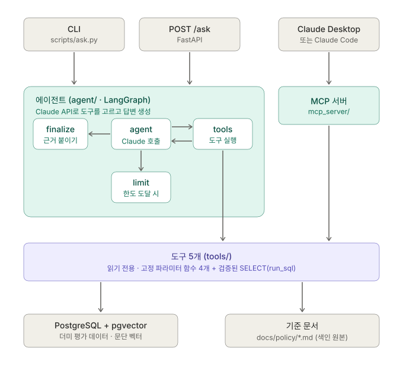

# eval-agent



평가 데이터를 자연어로 물어보면, LLM이 필요한 도구를 직접 골라 DB를 조회하고 근거와 함께 답해 주는 서비스입니다. Python, LangGraph, MCP로 만들었고, 기준 문서는 임베딩(Voyage AI)과 벡터DB(pgvector)로 검색합니다. 데이터는 모두 더미입니다.

## 어떤 질문에 답하나

- 2025년 본부별 B등급 비율을 비교해줘
- 영업본부 등급 분포가 작년보다 어떻게 바뀌었어?
- 영업본부 B등급 비율이 높은 게 기준 문서상 허용되는 수준이야?
- 개발본부 다면평가 평균은?
- 2023년 결과 보여줘 (데이터가 없으면 없다고 답해야 합니다)

### 데모 시나리오: 영업본부 B등급

더미 데이터에서 영업본부의 2025년 B등급 비율을 일부러 기준보다 높게 만들어 두었습니다. "영업본부 B등급 비율이 높은 게 기준 문서상 허용되는 수준이야?"를 물으면, 에이전트는 아래 근거를 도구로 확인해서 답합니다.

| 확인할 것 | 쓰는 도구 | 도구가 돌려주는 값 |
|-----------|-----------|--------------------|
| 영업본부 B등급 비율의 변화 | `compare_years` | 2024년 51.7% → 2025년 68.3% (+16.7%p, 세 평가유형 합산 건수 기준) |
| 다른 본부와의 비교 | `get_grade_distribution` | 2025년 성과 기준 개발 48.8%, 경영지원 50%, 생산 51.4% |
| 기준 문서의 허용 범위 | `search_policy_docs` | 영업본부 B등급 상한 65% (일반 가이드는 40~60%) |

이 값만으로는 영업본부가 상한(65%)을 약 3.3%p 넘었다는 것까지만 말할 수 있습니다. 왜 높아졌는지는 데이터에 없으므로, 에이전트는 원인을 추측하지 않고 "추가 확인이 필요합니다"라고 답하도록 만들었습니다.

## 왜 만들었나

- Java/Spring으로만 일해서 Python 경험이 없었는데, Python 프로젝트와 LangGraph, MCP를 처음부터 끝까지 직접 해 보고 싶었습니다.
- 동작하는 코드만이 아니라 "왜 이렇게 만들었는지"를 설명할 수 있게, 단계마다 설계 이유와 한계를 작성했습니다.
- 이전에 [Spring AI로 평가 문의 자동 분류 시스템](https://github.com/kjennn/hr-eval-inquiry-triage)을 만들었는데, 그건 정해진 순서대로 도는 워크플로였습니다. 
- 이번에는 LLM이 어떤 도구를 부를지 직접 고르는 에이전트로 만들어서 둘의 차이를 비교해 보려고 했습니다.

## 사용 방법은 두 가지입니다

같은 도구 5개를 두 가지 방식으로 쓸 수 있습니다.

| | 에이전트 (CLI, API) | MCP 서버 (Claude Desktop/Code) |
|---|---|---|
| LLM | 내 코드가 Claude API를 호출 | 클라이언트(Claude Desktop/Code)의 Claude |
| 필요한 것 | DB, 시드, Claude API 키 | DB, 시드, 클라이언트 설정 |
| 비용 | 호출마다 Claude API 사용료 | 이 서버 자체는 없음 (클라이언트 계정의 사용량) |
| 답변 통제 | 반복 한도, 근거 자동 첨부, "추가 확인이 필요합니다" 규칙을 내 코드가 적용 | 적용되지 않음. 도구 설명만 보고 클라이언트가 답함 |

도구를 제공하는 것과 안전한 답변을 보장하는 것은 별개입니다. 답변 규칙이 중요하면 에이전트 방식으로 쓰고, 편하게 조회만 하려면 MCP로 씁니다.

## 준비물

Python 패키지 관리자 [uv](https://docs.astral.sh/uv/)와 Docker가 설치되어 있어야 합니다.

| 하고 싶은 것 | Docker DB | 시드 | Claude API 키 | Voyage API 키 |
|--------------|-----------|------|----------------|---------------|
| 테스트 (`pytest`) | 불필요 (메모리 SQLite) | 불필요 | 불필요 | 불필요 |
| CLI, API | 필요 | 필요 | 필요 (`.env`) | 선택 |
| MCP 서버 | 필요 | 필요 | 불필요 | 선택 |

Voyage API 키는 기준 문서를 임베딩으로 검색할 때만 씁니다. 없으면 키워드 검색으로 동작하고, 나머지 기능은 그대로입니다.

## 빠른 시작

```bash
git clone https://github.com/kjennn/eval-agent.git
cd eval-agent
cp .env.example .env                  # 설정 파일 생성 (.env는 커밋되지 않습니다)
docker compose up -d                  # PostgreSQL(+pgvector) 기동
uv sync                               # 가상환경과 의존성 설치
uv run python scripts/seed.py         # 테이블 생성과 더미 데이터 입력
uv run pytest                         # 테스트 (API 호출이나 비용 없음)
```

`seed.py --reset`은 모든 데이터를 지우고 다시 만드니, 데이터가 있는 DB에서는 신중하게 쓰세요.

CLI나 API를 쓰려면 `.env`에 Claude API 키와 모델명을 넣습니다. 모델명은 코드에 기본값이 없어서 `.env`에 꼭 지정해야 합니다. `.env.example`에는 개발용으로 `claude-haiku-5-5`가 적혀 있고, 지원되는 모델명은 바뀔 수 있으니 사용 전에 확인하세요. API 키는 `.env`에만 넣고 코드나 커밋에 넣지 않습니다.

```bash
# 에이전트 (CLI)
uv run python scripts/ask.py "개발본부 다면평가 평균은?"
uv run python scripts/ask.py -v "..."            # -v: 도구 호출 과정을 단계별로 출력

# 에이전트 (API) - 실행 후 http://127.0.0.1:8000/docs 에서 Swagger로 호출해 볼 수 있습니다
uv run uvicorn eval_agent.api.app:app --host 127.0.0.1 --port 8000
```

API는 인증이 없고 호출마다 비용이 드니, 외부에 공개하지 않습니다. Claude Desktop/Code에서 도구를 쓰려면 [MCP 서버 연결 가이드](docs/mcp-setup.md)를 따라 하세요.

기준 문서를 임베딩으로 검색하려면 `.env`에 `VOYAGE_API_KEY`와 `EMBEDDING_MODEL`을 넣고 색인을 한 번 만듭니다. 키 발급 방법은 [임베딩 검색 작업 기록](docs/embedding-search.md)의 0단계에 있습니다.

```bash
uv run python scripts/index_policy.py      # 기준 문서 20개 문단을 임베딩해 pgvector에 저장
uv run python scripts/trace_search.py      # 임베딩 모델과 pgvector를 실제로 쓰는지 한 번에 확인
```

## 도구 5개

| 도구 | 하는 일 |
|------|---------|
| `get_grade_distribution` | 연도(와 본부, 평가유형)별 S/A/B/C/D 등급 인원과 비율을 조회합니다. |
| `compare_years` | 한 본부의 두 연도 등급 분포를 비교하고 변화량(%p)을 계산합니다. |
| `get_org_summary` | 한 본부의 인원수, 평균 점수, 평가유형별 평균을 조회합니다. |
| `search_policy_docs` | 기준 문서(등급 배분 가이드 등)에서 질문과 의미가 가까운 문단을 찾습니다. 임베딩 + pgvector를 먼저 쓰고, 쓸 수 없으면 키워드 검색으로 대체합니다. |
| `run_sql` | (Text-to-SQL) LLM이 쓴 SELECT 문을 검사한 뒤 읽기 전용으로 실행합니다. 위 도구로 답할 수 없는 질문에만 씁니다. |

Spring에 비유하면 `tools/`가 서비스 계층이고, 에이전트(+API)와 MCP 서버는 같은 서비스를 서로 다른 방식으로 노출하는 컨트롤러입니다.

## 설계 원칙

- **기본 도구는 자유 SQL을 받지 않도록 제한했습니다.** 정해진 파라미터만 받는 읽기 전용 함수입니다. 예외인 `run_sql`은 SQL을 파싱해 SELECT 하나만, 허용 테이블 4개만, 직원 이름 없이, 최대 50행까지 읽기 전용 트랜잭션으로 실행합니다. 다만 DB 계정 자체는 읽기 전용으로 분리하지 않았습니다(아래 한계 참고).
- **숫자는 코드가 계산하고 근거도 코드가 붙입니다.** 변화량(%p)은 건수로 코드가 계산하고, 답변 끝의 "어떤 도구를 어떤 조건으로 불렀는지"는 호출 기록에서 뽑아 붙입니다.
- **모르는 것은 모른다고 합니다.** 도구로 확인한 숫자만 사실로 말하고, 데이터에 없는 원인은 "추가 확인이 필요합니다"라고 답합니다.
- **에이전트는 통제하고, MCP는 통제하지 않습니다.** 에이전트에는 반복 한도와 근거 첨부가 있고, MCP로 쓰면 이 규칙이 적용되지 않습니다.
- **외부 서비스가 실패해도 검색은 멈추지 않습니다.** 임베딩 API 장애, 요청 제한, 색인 없음일 때는 키워드 검색으로 대체하고, 결과의 `method`와 `fallback_reason`에 그 사실을 적습니다.
- **개인 이름 없이 집계만 다루고, 데이터는 전부 더미입니다.**

각 결정의 이유는 [설계 결정과 부딪힌 문제](docs/design-decisions.md)에 정리했습니다.

## 검증 현황

2026-11-20 기준입니다. 숫자와 결과는 코드를 고치면 달라질 수 있으니, 직접 `uv run pytest`로 다시 확인하세요.

확인한 것

- `uv run pytest`: 102개 통과, 4개 건너뜀. 가짜 LLM, 가짜 임베더, 메모리 SQLite, MCP 클라이언트를 써서 API 호출이나 비용이 들지 않습니다. 건너뛴 4개는 실제 PostgreSQL + pgvector 테스트로, `RUN_PG_TESTS=1`을 붙이면 돌고 모두 통과합니다.
- 실제 Claude API로 CLI와 `POST /ask`를 호출해서 테스트 질문의 답변과 근거 첨부를 확인했습니다. (2026-10-23, 도구 4개 시점)
- MCP 서버를 실제 stdio로 띄워 도구 호출을 확인했고, Claude Desktop에 연결해서 질문한 결과 도구를 써서 답하는 것을 확인했습니다. 도구 5개(`run_sql` 포함)로도 다시 확인했습니다.
- `run_sql`을 실제 PostgreSQL에서 확인했습니다. 집계 쿼리가 정상으로 나오고, 검사기를 건너뛰고 보낸 DELETE도 READ ONLY 트랜잭션이 거절합니다.
- 실제 Voyage 임베딩(`voyage-4`)으로 기준 문서 검색을 확인했습니다. 문서에 답이 있는 질문 5개에서 임베딩 5/5, 키워드 3/5 정답이었고, 무관한 질문 1개는 둘 다 결과 없음이었습니다. (아래 변경 이력 참고)

확인하지 못한 것

- 답변 품질을 체계적으로 평가하지 못했습니다. 테스트 질문 외의 다양한 질문은 해 보지 않았습니다.
- 같은 질문을 반복해서 답변이 안정적인지는 재 보지 않았습니다.
- 에이전트(CLI/API)에서 Claude가 `run_sql`과 임베딩 검색을 알맞게 쓰는지는 실제 Claude API로 아직 확인하지 않았습니다.

## 한계와 다음 단계

한계

- 인증과 호출 횟수 제한이 없습니다. API는 호출마다 Claude API 비용이 드니 외부에 공개하면 안 됩니다.
- 질문마다 독립 실행이라 대화 기억이 없습니다. "그럼 개발본부는?" 같은 후속 질문을 이해하지 못합니다.
- 임베딩 검색은 질문마다 Voyage API를 한 번 부릅니다. 결제 수단을 등록하지 않은 계정은 분당 3회로 제한돼서, 짧은 시간에 여러 번 검색하면 일부는 키워드 검색으로 대체됩니다.
- 유사도 하한(0.4)은 질문 12개로 정한 값이라 근거가 넉넉하지 않습니다. 모델을 바꾸면 다시 재야 합니다.
- DB 계정이 읽기 전용으로 분리되어 있지 않습니다. 고정 파라미터 도구는 읽기 전용 함수이고 `run_sql`은 SQL 검사와 READ ONLY 트랜잭션으로 막지만, 운영이라면 계정 수준에서도 막아야 합니다.
- 더미 데이터라 규모가 작습니다(250명, 2개 연도). 실제 규모에서의 성능은 모릅니다.

다음 단계

- **평가 세트를 만들어 자동 채점합니다.** 질문마다 아래 항목을 정해 두고 에이전트를 돌려 비교합니다.

  | 평가 항목 | 확인하는 것 | 예 (영업본부 B등급 질문) |
  |-----------|-------------|--------------------------|
  | 기대 도구 | 알맞은 도구와 인자를 골랐는가 | `compare_years(영업본부, 2024, 2025)`, `search_policy_docs` |
  | 기대 수치 | 답변의 숫자가 도구 결과와 같은가 | 68.3%, +16.7%p, 상한 65% |
  | 근거의 정확성 | 첨부된 근거가 실제 호출 기록과 같은가 | 호출한 도구와 조건이 그대로 표시됨 |
  | 원인 추측 여부 | 데이터에 없는 원인을 지어내지 않았는가 | "추가 확인이 필요합니다"로 답함 |
  | 데이터 없음 처리 | 없는 연도에 없다고 답하는가 | "2023년 데이터가 없습니다" |

- 대화 기억(LangGraph 체크포인터)
- 로컬 임베딩 모델(bge-m3)을 `Embedder` 구현체로 추가해 Voyage와 비교
- 응답 스트리밍, 인증, 호출 횟수 제한
- 읽기 전용 DB 계정 분리, MCP 서버의 원격(HTTP) 전환

## 변경 이력

처음 버전(1~6단계)을 만든 뒤 두 가지를 더 해 봤습니다. 둘 다 [PR #1](https://github.com/kjennn/eval-agent/pull/1)에 있습니다.

| 시점 | 내용 | 기록 |
|------|------|------|
| 2026-10 | 1~6단계: 도구 4개, LangGraph 에이전트, FastAPI, MCP 서버 | [단계별 구현 기록](docs/build-log.md) |
| 2026-11 | Text-to-SQL 도구 `run_sql` 추가 | 아래 요약 |
| 2026-11 | 기준 문서 검색을 키워드에서 임베딩 + 벡터DB(pgvector)로 전환 | [임베딩 검색 작업 기록](docs/embedding-search.md) |

### Text-to-SQL 도구 `run_sql`

고정 파라미터 도구로는 "직급별 평균 점수" 같은 질문에 답할 수 없어서, LLM이 직접 SELECT 문을 쓰게 하는 보조 도구를 붙였습니다. "자유 SQL은 받지 않는다"는 원칙의 예외라서, SQL을 실행하기 전에 파싱해서 검사합니다(SELECT 한 문장, 허용 테이블 4개, 직원 이름 차단, 위험 함수 차단, 최대 50행). 실행은 READ ONLY 트랜잭션과 3초 타임아웃 안에서 합니다.

### 키워드 검색에서 벡터DB로

처음에는 기준 문서를 키워드로 검색했습니다. [이전 프로젝트](https://github.com/kjennn/hr-eval-inquiry-triage)에서도 pgvector를 계획했다가, Anthropic에 임베딩 API가 없어서 키워드 검색으로 바꿨었습니다. 이번에는 Anthropic이 권장하는 Voyage AI로 임베딩을 만들고 pgvector에 저장해서 실제로 써 봤습니다.

- 바꾼 것: DB 이미지를 `pgvector/pgvector:pg16`으로 교체, 문단 20개를 임베딩해 `policy_chunk` 테이블에 저장(`index_policy.py`), 검색은 코사인 거리(`<=>`)로 가까운 문단을 찾음
- 바꾸지 않은 것: 도구 이름, 파라미터, 결과 모양. 그래서 에이전트, MCP 서버, 프롬프트는 그대로입니다. 키가 없거나 실패하면 예전 키워드 검색으로 돌아갑니다.

같은 질문으로 두 방식을 비교한 결과입니다(`voyage-4`, 괄호는 1위의 코사인 유사도).

| 질문 | 키워드 | 임베딩 |
|------|--------|--------|
| 영업본부 B등급 허용 상한 | 정답 | 정답 (0.582) |
| 영업본부가 B를 많이 줘도 돼? | 결과 없음 | 정답 (0.479) |
| 평가 결과가 억울하면 어떻게 해? | 오답 | 정답: 이의신청 (0.492) |
| 팀원이 다섯 명뿐인 팀도 비율을 지켜야 해? | 정답 | 정답 (0.564) |
| 성과평가랑 역량평가 반영 비중 | 정답 | 정답 (0.654) |
| 우주선 연료 보급 일정 (무관한 질문) | 결과 없음 | 결과 없음 |

조사가 붙거나("영업본부가") 단어가 전혀 겹치지 않는("억울하면" → 이의신청) 질문에서 차이가 났습니다. 문단이 20개뿐이라 사실 벡터DB가 꼭 필요한 규모는 아니지만, 이미 있는 PostgreSQL에 확장만 켜면 돼서 인프라를 늘리지 않고 써 볼 수 있었습니다. 실제로 임베딩 모델과 pgvector가 쓰였는지 확인하는 방법은 [임베딩 검색을 정말 썼는지 확인하는 법](docs/verify-embedding-search.md)에 정리했습니다.

## 문서

| 문서 | 내용 |
|------|------|
| [Python이 처음이라면](docs/guide-python.md) | Java/Spring 개발자를 위한 Python 프로젝트 읽는 법, 파일과 문법 대응표 |
| [설계 결정과 부딪힌 문제](docs/design-decisions.md) | 설계 결정의 이유, 만들면서 겪은 문제, 에이전트와 MCP의 책임 차이 |
| [MCP 서버 연결 가이드](docs/mcp-setup.md) | Claude Desktop/Code 연결 방법 |
| [단계별 구현 기록](docs/build-log.md) | 1~6단계의 실행 방법, 그때 정한 것, 테스트, 한계 |
| [임베딩 검색 작업 기록](docs/embedding-search.md) | Voyage 가입부터 pgvector 색인, 키워드와의 비교, 유사도 하한 조정까지 단계별 기록 |
| [임베딩 검색을 정말 썼는지 확인하는 법](docs/verify-embedding-search.md) | 검색 한 번을 따라가며 임베딩 모델과 pgvector가 쓰였다는 증거를 확인하는 법 |
