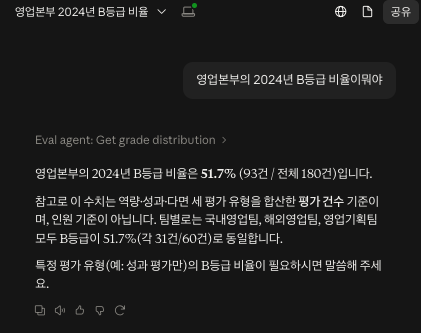

# MCP 서버 연결 가이드

서버는 stdio 방식입니다. Claude Desktop/Code가 이 프로세스를 직접 실행하고 표준 입출력으로 통신합니다. 포트를 열지 않아서 내 PC 밖에서는 접속할 수 없습니다. DB(`docker compose up -d`)는 켜져 있어야 합니다.

서버가 뜨는지만 직접 확인해 보기 (멈춰 있으면 정상, 종료는 Ctrl+C):

```bash
uv run python -m eval_agent.mcp_server
```

Claude Desktop 연결: 설정 파일(macOS: `~/Library/Application Support/Claude/claude_desktop_config.json`, 앱의 Settings → Developer → Edit Config로도 열립니다)에 추가합니다. 경로는 모두 절대 경로로 씁니다. `command`는 `which uv`로 나온 경로를 씁니다.

```json
{
  "mcpServers": {
    "eval-agent": {
      "command": "/절대/경로/uv",
      "args": ["--directory", "/Users/내이름/workspace/eval-agent", "run", "python", "-m", "eval_agent.mcp_server"]
    }
  }
}
```

설정 파일에 이미 `preferences` 같은 항목이 있으면, `mcpServers`를 그 안쪽이 아니라 같은 최상위 수준에 쉼표로 이어 붙입니다. 안쪽에 넣어도 JSON 문법은 맞아서 오류 없이 조용히 무시되고 로그도 남지 않습니다. 수정 후 `python3 -m json.tool <설정파일>`로 문법을 확인합니다.

저장한 뒤 Claude Desktop을 완전히 종료(Cmd+Q)했다가 다시 실행합니다. Settings → Developer에 `eval-agent`가 `running`으로 보이면 연결된 것입니다. 로그는 `~/Library/Logs/Claude/mcp*.log`에 있습니다.

Claude Code 연결 (Claude Code를 설치한 경우):

```bash
claude mcp add --transport stdio eval-agent -- /절대/경로/uv --directory /Users/내이름/workspace/eval-agent run python -m eval_agent.mcp_server
claude mcp list        # Connected 로 나오면 연결됨
```

연결한 뒤 "2025년 본부별 B등급 비율을 비교해줘" 같은 질문을 하면 Claude가 이 서버의 도구를 골라 호출합니다.

Claude Desktop에서 실제로 질문한 화면입니다. Claude가 `Eval agent: Get grade distribution` 도구를 호출해서 영업본부의 2024년 B등급 비율(51.7%)을 답했습니다. 이 답변에는 3단계 도구에서 정한 단위 설명(평가 건수 기준)이 그대로 반영되어 있습니다.



[README로 돌아가기](../README.md)
